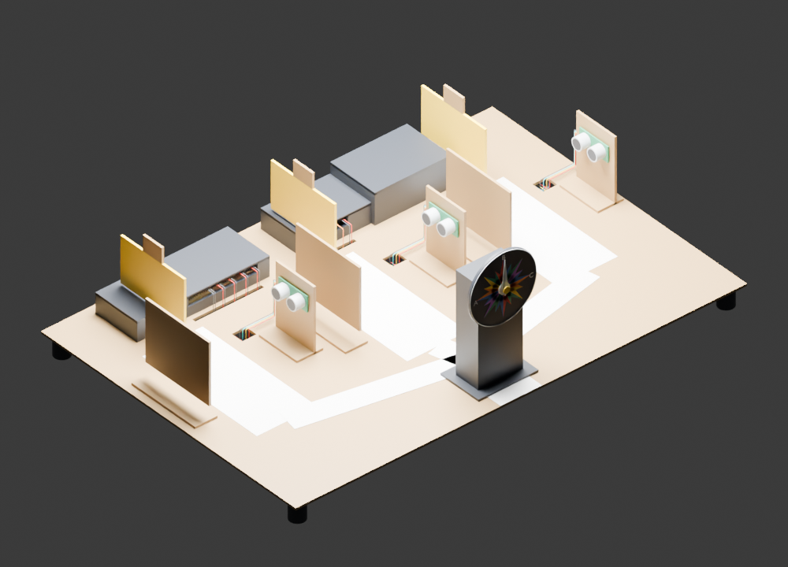

# Bússola de Fluxo Urbano

**Projetos I · Grupo 12 · CESAR School · 2026.2**

Uma bússola física torna visível qual das três rotas apresenta mais passagens no intervalo de observação. A maquete de 60 × 40 cm demonstra a cadeia de detecção, contagem, comparação e movimento do ponteiro.

[Explorar a maquete 3D](https://guilhermeabaoliveira.github.io/bussola-fluxo-urbano/atlas-3d/) · [Blueprint interativa](https://guilhermeabaoliveira.github.io/bussola-fluxo-urbano/blueprint/) · [Explainer](https://guilhermeabaoliveira.github.io/bussola-fluxo-urbano/explainer/) · [Apresentação](https://guilhermeabaoliveira.github.io/bussola-fluxo-urbano/apresentacao/) · [Manual](docs/manual.md)



## O que está disponível

| Material | O que apresenta |
|---|---|
| Maquete 3D | Rotação, zoom, camadas, transparência, peças isoladas e ligações identificadas |
| Blueprint | Caminho das leituras até a decisão do ponteiro, com exemplos interativos |
| Explainer | Documento estruturado sobre propósito, componentes, funcionamento e limitações |
| Arduino: um sensor | Diagnóstico de distância com HC-SR04, TRIG D2 e ECHO D3 |
| Arduino: três sensores | Integração A D2/D3, B D4/D5, C D6/D7, servo D9 |

## Abrir no computador

Baixe e extraia a pasta completa. Para explorar o modelo sem instalar dependências, abra `atlas-3d/atlas-autonomo.html` no navegador com WebGL habilitado. Para abrir o portal com todos os materiais, execute na raiz:

```sh
python -m http.server 8767 --bind 127.0.0.1
```

Abra `http://127.0.0.1:8767/`. O servidor fica restrito ao próprio computador. O [manual](docs/manual.md) explica navegação e apresentação no Acer Nitro.

## Evidências e limites

O grupo relatou funcionamento de uma unidade HC-SR04 em 18/11/2026. A integração física dos três sensores e do servo permanece como ensaio a realizar. A animação representa entradas controladas e não comprova desempenho em parque público.

O HC-SR04 mede distância; não classifica pessoas, cães ou outros alvos. Tecnologias de implantação urbana são discutidas separadamente na [pesquisa de escala real](docs/escala-real.md).

[Montagem por contato](docs/montagem.md) · [Escopo](docs/escopo.md) · [Ensaios](docs/testes.md) · [Segurança e publicação](docs/seguranca.md) · [Histórico](CHANGELOG.md)

## Equipe

Guilherme Alcântara Batista Alencar de Oliveira; Samuel Bernardi Sá; Enzo Leal Cavalcanti; Maria Alice Rocha de Alcantara; João Victor Teixeira de Albuquerque Maranhão; Mateus Dias Dino; João Guilherme Sousa Gomes; Pedro Henrique de Freitas Veloso.

As responsabilidades e resultados devem refletir as atividades efetivamente realizadas pelo grupo. Esta documentação não atribui autoria individual sem registro correspondente.

## Dependências e direitos

A visualização usa Three.js e componentes locais. Veja [terceiros](THIRD_PARTY_NOTICES.md). Uma licença para o trabalho autoral do grupo ainda precisa ser definida pelos responsáveis; a preparação desta pasta não concede licença sobre imagens ou materiais de terceiros.
